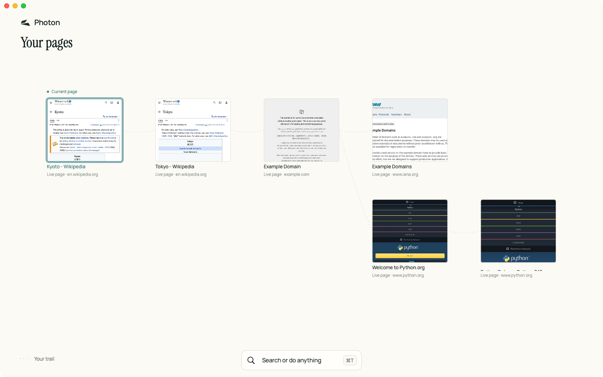
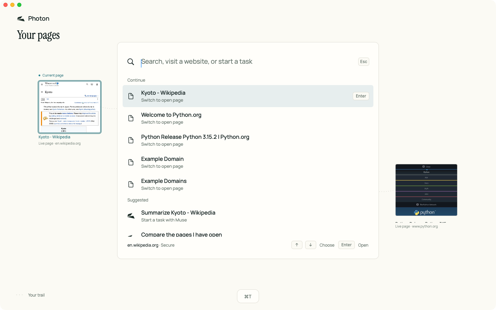
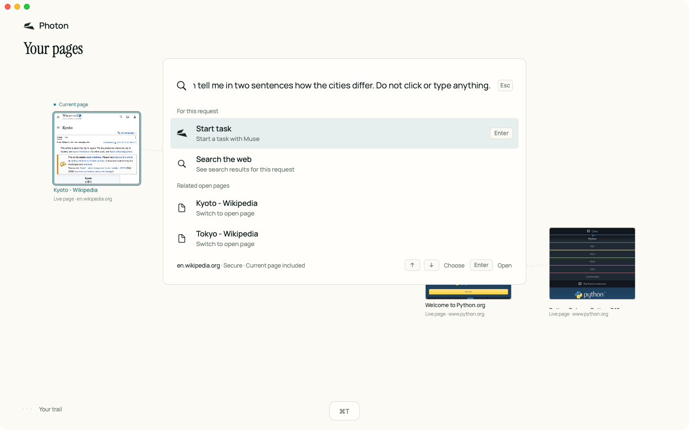
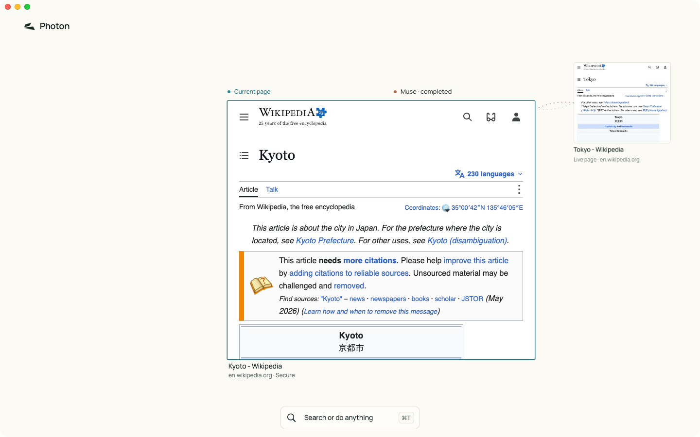

# Photon

Photon is a native macOS browser by Barestate. Your open pages sit on one canvas, and Muse, Meta's agent, can work in them: reading a page, clicking and typing in your real session, from the Mac or from a phone. You can take over at any moment, sensitive actions wait for your approval, and every action leaves a verified record. There is no toolbar, tab strip, address bar or sidebar: you press ⌘T and type a URL, a search, a tab to switch to, or a request for Muse. The browser is Swift and AppKit around Chromium Embedded Framework (CEF 156).



## Benchmarks

**[BENCH.md](BENCH.md) has every budget with its command, sample count and raw output.** Headline figures, measured on the release bundle (M4 Mac, macOS 27.0.1):

- Launch to first paint, warm cache: p50 240.55 ms (budget 1500 ms).
- One open page: Photon 199.4 MiB, Chrome 522.8 MiB (p50 of 5 runs each).
- ⌘T to a usable launcher: p95 3.15 ms (budget 50 ms). Atom grounds a click in a median 325.5 ms (budget 500 ms).
- Misses, also in BENCH.md: the first launch after a new signature takes p50 1761.1 ms, and 20 real public pages take 1733.8 MiB against Chrome's 1486.4 MiB.

## Install

Needs a Mac with Apple silicon and macOS 14 or later.

1. Download `Photon-0.1.0.dmg` from the [v0.1.0 release](https://github.com/barestate-ai/photon/releases/tag/v0.1.0) of `github.com/barestate-ai/photon`. The repository is private, so sign in to an account with access; or `gh release download v0.1.0 --repo barestate-ai/photon --pattern Photon-0.1.0.dmg`.
2. Open the DMG and drag Photon onto the Applications shortcut. Eject the disk image.
3. The app is ad-hoc signed, not notarized, and a browser download is quarantined, so macOS blocks the first launch. Open Photon once and dismiss the warning. Then open **System Settings → Privacy & Security**, scroll to the Security section, click **Open Anyway** next to the message that "Photon" was blocked, and confirm with your password or Touch ID.
4. Open Photon again and choose **Open**.

The alternative to step 3 is to remove the quarantine mark: `xattr -dr com.apple.quarantine /Applications/Photon.app`.

`Photon-0.1.0.zip` on the same release works the same way: unzip it and move `Photon.app` to Applications. The first launch after a new signature takes longer than later ones, consistent with the OS assessing a new signature once; the exact cause was not isolated (D15).

## Muse key

Muse needs a model key. An app opened from the Dock or Finder has no `.env` file, so store the key in the Keychain once:

```sh
security add-generic-password -s meta-model-api -a "$USER" -w
```

The command prompts for the key, so it never appears on a command line or in your shell history. Photon reads the Keychain item `meta-model-api`; macOS may ask you to allow it. Settings → Model names this too. Without a key the browser works and "Start task" explains why Muse is unavailable.

Photon looks for the key in this order: `MODEL_API_KEY` in the environment, then in the `.env` file (the one named by `BARESTATE_ENV_FILE`, else `.env` in the working directory), then the Keychain. From a checkout, put `MODEL_API_KEY=...` in `.env` at the repo root (git ignores it).

## Atom (optional)

Atom is a small local model that turns "click Save" and a screenshot into a point, before Photon asks Muse. Without it the act ladder skips that step. Apple silicon only; it needs about 1.4 GB of disk (1.2 GB of runtime and 161 MB of model, measured with `du`).

Install it from Photon: **Settings (⌘,) → Atom → Install Atom**. The window shows the installer's progress, Cancel stops it, and a failed install says why in one line with a Try again button; when it finishes the section reads Ready and the next task uses Atom — no restart. The same install from a terminal:

```sh
/Applications/Photon.app/Contents/Resources/atom/setup-atom.sh   # from an installed app
make atom                                                        # from a checkout
```

It downloads a pinned Python 3.11 and its hash-locked packages into `~/Library/Application Support/Barestate/Runtime`, then the model into `~/Library/Application Support/Barestate/models/atom/tinyclick-4bit-v1/tinyclick-4bit`, checking every model file against its pinned size and SHA-256. The model comes from the public `https://download.barestate.xyz/atom-tinyclick-4bit-v1.tar.gz` (works for anyone, no account or auth; the `v0.1.0` GitHub release asset stays as the fallback; override with `ATOM_URL` or `ATOM_ARCHIVE=<file>`). The runtime is vendored in [runtime/atom/](runtime/atom/README.md). `BARESTATE_RUNTIME_DIR` and `BARESTATE_ATOM_MODEL` change the two directories; `BARESTATE_ATOM_PYTHON`, `BARESTATE_ATOM_RUNTIME` and `BARESTATE_ATOM_MODEL` tell the app where to look.

## Build locally

Needs Apple silicon, macOS 14 or later, the Xcode Command Line Tools (Swift 6), and `python3`. `Vendor/` takes about 675 MB; a release build and the bundle need several GB more.

```sh
make vendor                 # fetch and verify the pinned CEF builds into Vendor/ (idempotent)
make bundle                 # build release and assemble .build/Photon.app, ad-hoc signed
scripts/run-app.sh          # run the bundle in the foreground; arguments go to the app
make check                  # build, unit tests, secret scan, license check, lint
make e2e                    # the end-to-end suite against the real bundle
make dmg                    # dist/Photon-0.1.0.dmg from the bundle (no second build)
scripts/release.sh          # dist/Photon-0.1.0.zip (make dist does the same)
```

`.build/Photon.app` is the only app bundle; `make dmg` and `scripts/release.sh` pack it and never build a second copy. The version is `CFBundleShortVersionString`. `dist/` is git-ignored and also holds the model archive (`make atom-archive`); do not run `make clean`, which removes it along with `.build/`.

`make check` runs the unit tests (`swift test`), `scripts/check-secrets.sh`, a license check and `swift format lint`. `make e2e` launches the bundle with test hooks and drives it through its own socket, never through the real cursor or keyboard. Run it alone: it opens windows and a fixture server and needs a quiet machine. Tests that call a real model are skipped, and reported as not run, unless `BARESTATE_LIVE_META=1` and a key are set.

## What it does

- **Overview canvas.** Every open page is a card with its own captured preview. Pan and zoom the canvas. Links and popups connect pages into a trail. Muse's own steps draw in copper.
- **⌘T.** One launcher for URLs, web search, switching tabs, and requests for Muse, with local suggestions.

  

- **Ask Muse.** Type a request and choose "Start task". Muse runs on the model `muse-spark-1.3`, sees the pages you give it, and acts on them. The page it works on shows a "Muse" label and the trail of what it read.

  

- **Focused page with context.** A page fills the window; its neighbours stay visible at the edges.

  

- **Approvals and takeover.** A delete, a purchase, a password field or a submit control waits for your Allow once. Clicking in a page you gave to Muse takes it back at once.
- **Remote.** Turn Remote on in Settings and pair a phone. The phone page shows the run and its approvals.

The four screenshots were captured from the running app with `test.screenshot` at 1440 × 900, on real public pages. [DEMO.md](DEMO.md) has the shot list and the 70 s demo video, [HACKATHON.md](HACKATHON.md) separates what existed before the mission from what was built during it (and explains why the published history is a clean re-commit, so the commit hashes in the docs do not resolve), and [DECISIONS.md](DECISIONS.md) records the decisions, fail triggers and measured results.

## Connect Muse

- **Muse app, always on (a Custom Connector).** Turn Remote on in Photon's Settings and pair. In Muse, add a Custom Connector whose URL ends in `/barestate/mcp` and whose credential is the bearer token Photon shows once. Full steps and the security notes are in [docs/muse.md](docs/muse.md). This path is **not verified** against a real Muse account (FT5 in DECISIONS.md).
- **Muse Code, on this Mac.** Add the bundled `Photon.app/Contents/MacOS/barestate-mcp` as a stdio MCP server in Muse Code's settings. It forwards to the running Photon over a local socket. See [docs/muse-code.md](docs/muse-code.md).

## License

Apache-2.0, see [LICENSE](LICENSE). Manrope and Instrument Serif are bundled under their SIL Open Font License texts in `Resources/Fonts/`.
